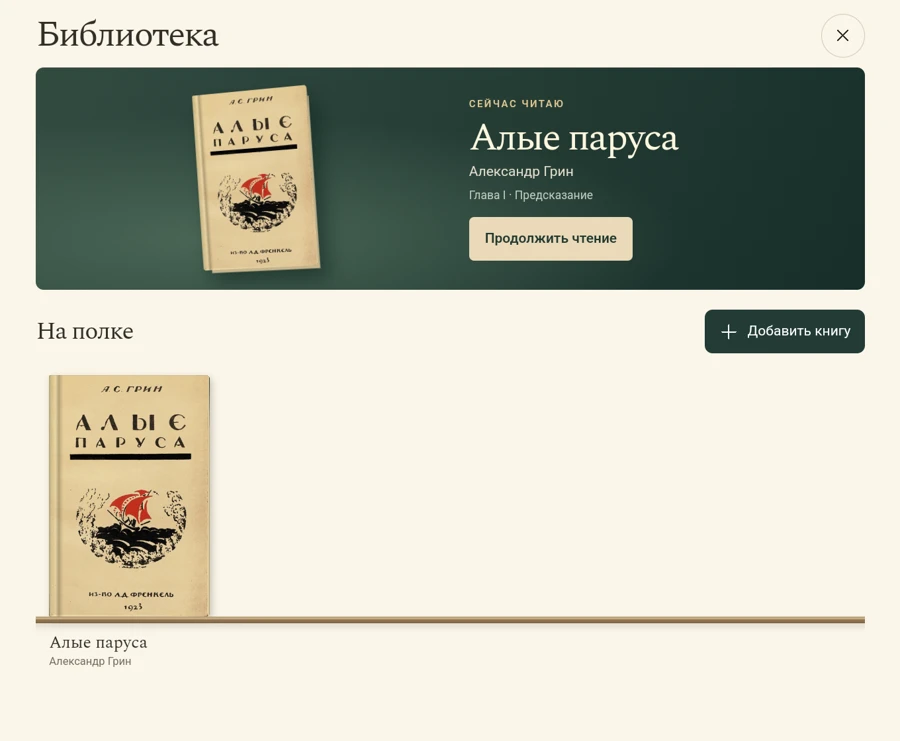

# Foldread

Офлайн-читалка для Android с книжным разворотом. На раскрытом Galaxy Z Fold8 страницы разделяет поле вдоль середины экрана. На узком экране приложение показывает одну страницу. При смене размера окна или шрифта место привязано к символу внутри абзаца.

[Скачать подписанный APK для Android 8 и новее](https://github.com/kschkn/Foldread/releases/latest)



## Чтение

- При первом запуске открывается повесть Александра Грина «Алые паруса».
- Чтение открывается на весь экран. Коснитесь центра, чтобы показать или убрать панели.
- Чтобы добавить свою книгу, нажмите «Библиотека» → «Добавить книгу». Можно выбрать отдельный FB2 или EPUB либо архив ZIP, 7z или RAR без пароля. Если в архиве одна книга, она откроется сразу. Если несколько, выберите нужный файл из списка. Одна и та же книга сохраняет место чтения при повторном открытии из другого архива.
- Потяните страницу влево или вправо. Лист следует за пальцем и остаётся на месте, пока вы его держите. Отведите палец обратно к началу жеста и отпустите, чтобы отменить перелистывание. Можно также коснуться края страницы или использовать стрелки на панели.
- На устройстве с датчиком угла шарнира можно перелистнуть вперёд сгибом. На полном развороте со скрытым меню согните телефон до книжного положения и раскройте в течение трёх с половиной секунд. Полное закрытие сбрасывает жест. Управление сгибом включается и выключается в «Аа».
- Нажмите название главы внизу, чтобы открыть оглавление, закладки или поиск по тексту. При переходе к другой главе, закладке или результату поиска появляется кнопка «К месту чтения». Она помнит исходное место до возврата, в том числе после перезапуска. Значок закладки вверху сохраняет разворот надолго.
- В «Аа» → «Страница» регулируются внешние поля, отступ у сгиба, поля сверху и снизу и межстрочный интервал. Изменения сразу видны на книге. Во вкладке «Шрифт» у каждой гарнитуры есть образец на кириллице. Шрифты Spectral, Literata, PT Serif и Roboto входят в APK.
- Проведите вверх или вниз вдоль левого края, чтобы изменить яркость окна читалки. Команда «Аа» → «Экран» → «Вернуть системную яркость» снова включает яркость телефона.
- Коснитесь центра страницы, чтобы увидеть примерное время до конца главы. Нажатие на минуты открывает подробности. После обычных перелистываний вперёд оценка учитывает объём прочитанного и время на развороте.
- Нажмите подчёркнутый указатель сноски. На развороте текст примечания откроется на противоположной странице, на внешнем экране — снизу. Крестик закрывает сноску.

## Полка и инструменты

- На полке текущая книга открывается кнопкой «Продолжить чтение». Foldread показывает обложку из файла, а для книг без неё создаёт переплёт с именем автора. Тома с одинаковой серией собраны в стопку, внутри они упорядочены по номеру.
- В меню «•••» → «Анимация перелистывания» потяните миниатюру. Можно выбрать бумажный загиб с оборотом листа, классический книжный разворот, скольжение или мгновенную смену страницы. Выбранный эффект действует и при жесте шарниром.
- Удерживайте нижний край страницы и ведите пальцем вдоль него, чтобы просмотреть веер разворотов. Отпустите на нужном месте. Кнопка «К месту чтения» возвращает к тексту. Веер также открывается через «•••».
- Выберите «Цитата-открытка» и выделите фразу или коснитесь абзаца. В редакторе можно уточнить текст, сохранить PNG или поделиться им через Android.
- Команда «Пометка на полях» привязывает запись к абзацу. Коснитесь подчёркнутого абзаца, чтобы отредактировать запись, или откройте «Мои пометки» для перехода между главами.
- В «Иллюстрациях» можно открыть обложку, карту или рисунок, увеличить его двумя пальцами и перемещать по экрану.
- «Оригинал и перевод» открывает две книги рядом. У каждой страницы свои главы и перелистывание. Коснитесь по абзацу в каждой книге и нажмите «Связать абзацы». Сохранённая связь вновь открывает обе страницы. На внешнем экране книги переключаются кнопкой.
- В «Профилях чтения» можно сохранить два набора оформления, включая шрифт, кегль, поля, межстрочный интервал, тему и яркость.

## Android Auto

Текстовая читалка не входит в поддерживаемые категории приложений Android Auto. Для автомобиля возможна отдельная аудиоверсия с озвучиванием глав и управлением воспроизведением как у аудиокниги. Версия 0.4 предназначена для чтения на телефоне. [Категории приложений Android for Cars](https://developer.android.com/training/cars)

## Сборка

Откройте корень проекта в Android Studio. Для сборки нужны JDK 17 или 21, Android SDK Platform 34 и Build Tools 34.0.0. Для первой загрузки зависимостей нужен интернет.

В PowerShell с настроенными `JAVA_HOME` и `ANDROID_HOME`:

```powershell
.\gradlew.bat assembleDebug
```

APK появится в `app/build/outputs/apk/debug/app-debug.apk`. Для запуска из Android Studio выберите устройство с разрешённой отладкой по USB и нажмите Run.

Для подписанного релиза задайте переменные среды `FOLDREAD_KEYSTORE` (путь к собственному хранилищу с ключом `foldread`) и `FOLDREAD_KEY_PASSWORD` (пароль ключа и хранилища), затем выполните `gradlew.bat assembleRelease`. Релизный APK появится в `app/build/outputs/apk/release/`. Чтобы Android принял обновление поверх установленной версии, обе версии должны иметь одну подпись.

## Форматы

Поддерживаются FB2 и текстовые EPUB без DRM. Импорт учитывает кодировку XML в FB2, вложенные разделы и порядок чтения по spine в EPUB. Сноски используют ссылки исходной книги, в том числе ссылки на отдельные XHTML-файлы внутри EPUB. Для книг из версий до 0.4 повторно выберите исходный файл, чтобы добавить обложку, серию и растровые иллюстрации к существующей записи. Закладки и место чтения сохранятся. Foldread перевёрстывает текст, а рисунки помещает в отдельную галерею. Лимит исходного файла составляет 64 МиБ, одного XML или XHTML — 20 МиБ.

## Материалы

Текст «Алых парусов» взят из издания 1923 года. [Викитека](https://ru.wikisource.org/wiki/Алые_паруса_(Грин)/1923)

На полке использована обложка первого издания «Алых парусов» 1923 года. [Файл и сведения об издании на Wikimedia Commons](https://commons.wikimedia.org/wiki/File:Scarlet_Sails_first_edition_cover.jpg)

Лицензии на все четыре шрифта входят в приложение. [Google Fonts](https://github.com/google/fonts/tree/main/ofl)

Для разбора FB2 и содержимого EPUB используется jsoup. [jsoup и лицензия MIT](https://jsoup.org/license)

Архив может занимать до 512 МиБ. Лимиты для выбранной книги применяются после распаковки. Поддерживаются книги в папках архива. Для работы с архивами используется libarchive. [libarchive-android](https://github.com/zhanghai/libarchive-android)
